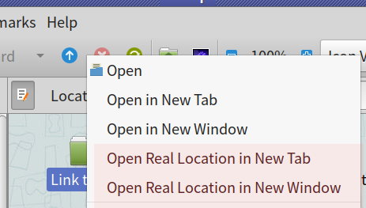

# Local changes on top of Caja 1.29.1

This repository is a fork of [caja](https://github.com/mate-desktop/caja).

* Branch `fixes-1.29.1` = upstream tag `v1.29.1` + the three commits listed
  below. Nothing else is changed: the tree is the upstream release tree with
  those commits applied.
* Branch `master` = upstream `master` with the same three commits merged in.
  It also carries everything upstream added between `v1.29.1` and `master`,
  so the patches were merged rather than just applied to the 1.29.1 tree.

The changes were written for the 1.29.1 tree. They are independent of each
other and can be dropped individually.

| # | Commit subject | Upstream issue |
| --- | --- | --- |
| 1 | `icon-container: Fix renaming when the scrollbar just appears` | [#1444](https://github.com/mate-desktop/caja/issues/1444) |
| 2 | `file-manager: Build a fresh popup menu for every popup` | – |
| 3 | `fm-directory-view: Show the size of selected folders in the status bar` | – |

## 1. Rename is cancelled when the scrollbar just appears

**Files:** `libcaja-private/caja-icon-container.c`

**Symptom:** with the icons overflowing the viewport by less than the
icon/container padding (16 pixels in total), pressing F2 or choosing
*Rename* from the context menu appears to do nothing.

**Cause:** the preferred size reported by `get_prefered_height()` (raw canvas
bounds, without padding) and the scroll region set by
`caja_icon_container_update_scroll_region()` (bounds plus padding) disagree.
`GtkScrolledWindow` then alternately shows and hides the vertical scrollbar,
which changes the container width and triggers a re-layout every time.
Starting a rename creates the rename widget and triggers one more allocation
pass; if that re-layout moves the icon being renamed,
`icon_set_position_full()` calls `end_renaming_mode(container, TRUE)` and the
rename is cancelled as soon as it starts.

**Fix:** the scroll region computation is factored into
`get_scroll_region_bounds()` and used both for setting the scroll region and
for the preferred size, so GtkScrolledWindow's scrollbar decision always
matches the real scrollable area.

## 2. Fresh popup menu for every popup

**Files:** `src/file-manager/fm-directory-view.c`

**Symptom:** right-clicking sometimes shows a context menu with an empty row
above and below the items, and the last entries silently disappear (the mouse
wheel can still reach them). The next right click looks fine again.

**Cause:** a `GtkMenu` that is already mapped keeps the size of its popup
window when its items change — `GtkWindow` only re-negotiates the size while
the menu is being popped up. The popup menus are long-lived children of the
window's `GtkUIManager`, shared by every right click and by both panes in
split view (F3), while a right click schedules a menu update (selection
change, file info refresh, clipboard, extension or script signals) that runs
one `update_interval` (100 ms by default) later — after the menu was popped
up. When the items grow, the popup stays too small and `gtk_menu_scroll_to()`
switches the menu into its "scrolling menu" mode: it reserves the scroll arrow
areas above and below the items and clips the items that no longer fit. Most
themes draw the insensitive arrow transparent, which looks like an empty row.

**Fix:** build the popup menu from scratch for every popup. The items come
from the window's merged UI (`gtk_ui_manager_get_ui()` returns the statically
and dynamically merged items, including the open-with, script, template and
extension ones) in a private `GtkUIManager` that shares the window's action
groups, so labels, icons, sensitivities and the activation callbacks are
unchanged. Every popup gets its own popup window sized for the items that menu
actually contains, and updates that arrive while a menu is open no longer
resize the menu being displayed (they apply to the next popup). The private
manager is destroyed when the menu closes; if the UI string cannot be rebuilt
the code falls back to the window's menu, so a popup is never lost.

The widget level tweaks caja applies to the window's menu (the forced images
of *Open* and of the application entries) are repeated for the new menu, so
the popup looks the same as before. The old and new popup menus were compared
with screenshots and are identical apart from the pointer/selection artefacts
of the test.

## Added feature: size of selected folders in the status bar

**Files:** `libcaja-private/caja-file.c`, `libcaja-private/caja-file.h`,
`libcaja-private/caja-file-private.h`,
`libcaja-private/caja-directory-async.c`,
`src/file-manager/fm-directory-view.c`,
`src/file-manager/fm-properties-window.c`

**Symptom:** selecting a folder only reported how many items it contains, not
how much space it uses. (Upstream reports `"Photos" selected (3 items) Free
Space: 198.0 GB`.)

**Behavior:**

```
"Photos" (3 items, 3 total, 5.4 kB) Free Space: 198.0 GB
"Photos" (3 items, 1,234 total, 5.4 kB) Free Space: 198.0 GB
"Photos" (1 item, >10k total, >10.2 MB) Free Space: 198.0 GB
"Empty" (0 items) Free Space: 198.0 GB
```

* The recursive total is shown even when it equals the number of direct
  entries (a folder without subfolders).
* An empty folder only shows its item count, because there is no recursive
  total or size to report.
* Selection labels no longer carry the word `selected` (`"Photos"`,
  `3 folders`, `3 items`); the details, the labels and the free space are
  joined by spaces and commas instead of the old `", "` runs.
* The count, the recursive count and the size describe the same set of files:
  several selected folders are summed, and an entry inside another selected
  entry is not counted twice.
* The size is the sum of `st_size`, the same "with size" number the properties
  window shows, and it follows the `use-iec-units` preference.

**Limits and interaction with the properties window:**

* Nothing new to configure. The values are only computed when the existing
  `show-directory-item-counts` speed tradeoff preference allows item counts
  for the file (default `local-only`, so remote folders are left alone), and
  never for the trash.
* While a count is running the status bar shows `…`.
* Walking a whole tree is bounded per request: the traversal only starts once
  the selection has been stable for 300 ms, and it stops after 10000 directory
  entries or 3 seconds, whichever comes first. A truncated result is shown as
  a lower bound with `>` and a compact entry count (`>10k total`, `>10.2 MB`)
  so the line does not grow by four digits.
* Such a truncated result must not be mistaken for an exact one, so the
  properties window marks it as a lower bound too
  (`Contents: ≥ 10,000 items (calculating…)`) until its own unlimited recount
  finishes and replaces it with the exact numbers.
* The limits are per request, through the new
  `caja_file_recompute_deep_counts_with_limits()`.
  `caja_file_recompute_deep_counts()` keeps its unlimited behavior, so the
  properties window still shows exact numbers, and an unlimited request lifts
  a limit that is already in effect.
* A request lasts as long as the folder stays selected: cancelling the
  `call_when_ready()` request also cancels the underlying traversal.

**Cost:** on the test machine a capped traversal took about 2 seconds for
`/usr/share`. The status bar never blocks the UI; the count runs
asynchronously.

## Added feature: open the real location of a symbolic link

**Files:** `src/file-manager/fm-actions.h`,
`src/file-manager/fm-directory-view.c`,
`src/file-manager/caja-directory-view-ui.xml`, `po/zh_CN.po`



**Symptom:** caja keeps the path of a symbolic link when it is opened as a
folder: the contents are the target's, but the location bar, the history and
the window title keep showing the link. That is useful when the link name
carries the meaning, but there was no way to get to the target folder itself
from the link - the target had to be read from the properties window and
typed into the location bar.

**Behavior:** the context menu of a selected symbolic link to a folder gets
two entries below *Open in New Window*, and the same two entries appear in the
background and path bar context menus of a folder that was opened through a
symbolic link:

* *Open Real Location in New Tab* opens the canonical path in a new tab
  (navigation windows only; hidden where tabs do not exist).
* *Open Real Location in New Window* opens the canonical path in a new
  navigation window.

The canonical path is the `realpath()` of the link, so every symbolic link in
the path is resolved, not just the last component: from
`/media/Temp/Link to caja` the new tab shows
`/media/Backup/Program/mate/fix/caja`.

The entries are only shown when they would change the path: for a selection
that contains a symbolic link to a folder, and for an open folder whose
canonical path differs from the displayed one. Broken links, non-local
locations (`trash:`, network) and paths that cannot be resolved (no search
permission) hide the entries instead of opening an error dialog. The new
strings carry a `zh_CN` translation.

**Cost:** nothing while the menus are closed; a popup calls `realpath()` once
per selected link, and once for the open folder when the background or path
bar menu is built.

**Patch:** `caja-1.29.1-open-real-location.patch` (applies after the three
commits listed above).

## Building

The tree has no generated `configure` script; run `autoreconf` first.

Dependencies (Debian/Ubuntu names): `exempi`, `gobject-introspection`,
`libnotify`, `libexif`, `gvfs`, `mate-common`, `mate-desktop`, plus the usual
build tools. `mate-common` provides the `MATE_COMPILE_WARNINGS` /
`mate-autogen` macros. The `mate-submodules` (libegg) sources are a git
submodule, so clone with `--recurse-submodules`.

```bash
git clone --recurse-submodules -b fixes-1.29.1 https://github.com/pasu11/caja.git
cd caja
autoreconf -fi
./configure --prefix=/usr --libdir=/usr/lib --sysconfdir=/etc \
            --localstatedir=/var --disable-static --disable-gtk-doc
make -j"$(nproc)"
sudo make install
```

An out-of-tree build fails to link libegg; configure in the source tree.

## Regenerating the patches

The branch commits are the canonical patches:

```bash
git format-patch v1.29.1..fixes-1.29.1
```

They can also be applied to a pristine 1.29.1 tree with `git am` or
`patch -p1`, in the order listed above. The first two apply with zero offsets;
the third applies on its own with zero offsets, and after the other two with an
offset on `src/file-manager/fm-directory-view.c` (the status bar patch inserts
code above `create_popup_menu()`), because it only touches the popup menu
construction.

The result is byte-identical to the compiled and smoke-tested patched tree:
status bar text (including truncated counts) and popup menus were checked on
2026-11-12/13.
