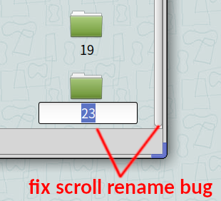
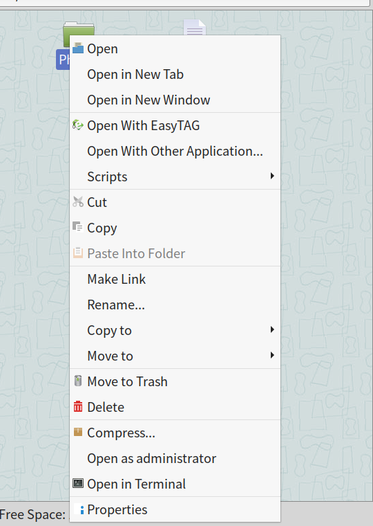
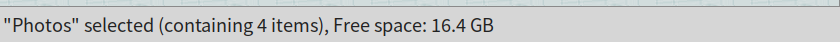
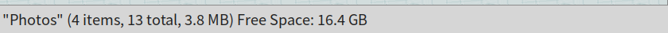
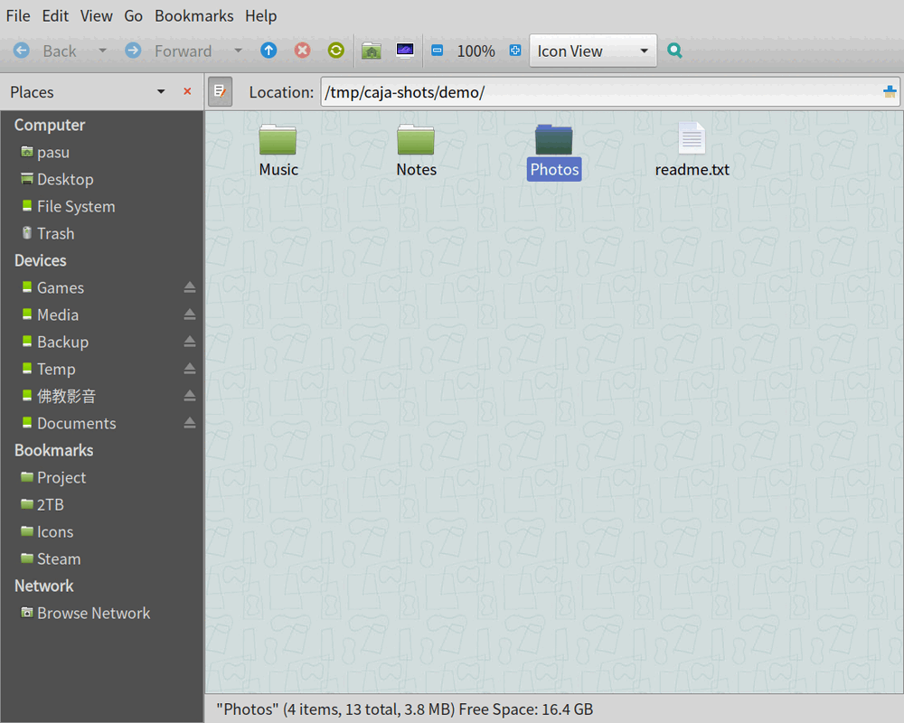
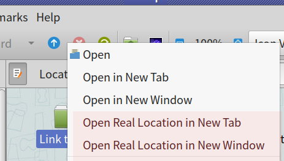
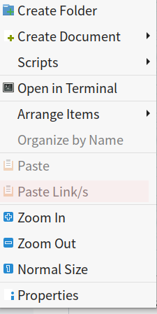

<p align="center">
  
</p>

<h1 align="center">Caja</h1>

<p align="center"><b>The file manager for the MATE desktop</b><br>
Personal fork of <a href="https://github.com/mate-desktop/caja">mate-desktop/caja</a>
with two fixes and three added features.</p>

<p align="center">
  <a href="https://github.com/pasu11/caja/blob/fixes-1.29.1/COPYING"></a>
  <a href="https://github.com/mate-desktop/caja"></a>
</p>

This is **not** the upstream project. Everything here is upstream Caja plus a
small set of patches; upstream bugs should be reported
[upstream](https://github.com/mate-desktop/caja/issues), not here.

| Branch | Base | Contents |
| --- | --- | --- |
| `fixes-1.29.1` (default) | upstream release tag `v1.29.1` | the 1.29.1 release + the two fixes and the three added features + these docs |
| `master` | upstream `master` (`4de76eb`) | unmodified upstream clone; no local changes |

The changes are independent of each other and can be dropped individually.
See [FIXES.md](FIXES.md) for the full technical description, the known limits
and how to regenerate the patches.

## Fixes

### 1. Rename is no longer cancelled when the vertical scrollbar appears

Fixes upstream issue [#1444](https://github.com/mate-desktop/caja/issues/1444).

When the icons overflow the viewport by less than the icon/container padding
(16 pixels in total), the preferred size and the actual scroll region
disagree, so `GtkScrolledWindow` alternately shows and hides the scrollbar and
re-lays out the view. Starting a rename triggers one more allocation pass; if
that moves the icon being renamed, `icon_set_position_full()` calls
`end_renaming_mode(container, TRUE)` and the rename is cancelled immediately.
F2 and the context-menu entry therefore appeared to do nothing whenever the
scrollbar was just starting to show.

The fix computes the scroll region once (`get_scroll_region_bounds()`) and
uses it both for the scroll region and for the preferred size, so the
scrollbar decision always matches the real scrollable area.



**File:** `libcaja-private/caja-icon-container.c`

### 2. Context menu is rebuilt for every popup

A mapped `GtkMenu` keeps the size of its popup window when its items change —
GTK only re-negotiates the size while the menu is being popped up. The popup
menus were long-lived children of the window's `GtkUIManager`, shared by every
right click and by both panes in split view, while a right click schedules a
menu update (selection, file info, clipboard, extension or script signals)
that runs 100 ms later, after the menu was shown. The menu then stayed too
small, `gtk_menu_scroll_to()` switched it into "scrolling menu" mode, and the
last entries were clipped behind empty scroll rows.

The popup menu is now built from scratch for every popup, from the window's
merged UI in a private `GtkUIManager` that shares the window's action groups,
so labels, icons, sensitivities and callbacks are unchanged. Updates that
arrive while a menu is open apply to the next popup, and the previous menu
keeps its size. If the UI string cannot be rebuilt, the code falls back to the
window's menu.



**File:** `src/file-manager/fm-directory-view.c`

## Added feature

### Folder size in the status bar

Selecting a folder now reports how much space it uses and how many entries it
contains in the whole tree, in one comma-separated list. The recursive total
is shown even when it equals the direct count.

Before (upstream):



After (this fork):





* An empty folder only shows its item count, because there is no recursive
  total or size to report.
* The selection label no longer contains the word `selected`
  (`"Photos"`, `3 folders`, `3 items`), and the parts are joined by spaces and
  commas instead of the old `", "` runs.
* Several selected folders are summed, and an entry inside another selected
  entry is not counted twice.
* The size is the sum of `st_size`, the same number the properties window
  shows, and it follows the `use-iec-units` preference.
* No new settings: the values are only computed when the existing
  `show-directory-item-counts` preference allows item counts for the file
  (default `local-only`, so remote folders are left alone), and never for the
  trash.
* Walking a whole tree is bounded: the traversal starts after the selection
  has been stable for 300 ms and stops after 10000 directory entries or
  3 seconds. A truncated result is presented as a lower bound, with the
  marker after the number for the count and after the unit for the size
  (`10k↑ total`, `994.9 MB↑`); the properties window marks it as
  `Contents: ≥ 10,000 items (calculating…)` until its own unlimited recount
  finishes.
* The capitalization of the free-space label is normalized (`Free Space`).

**Files:** `libcaja-private/caja-file.c`, `caja-file.h`,
`caja-file-private.h`, `caja-directory-async.c`,
`src/file-manager/fm-directory-view.c`, `fm-properties-window.c`

### Open the real location of a symbolic link

Caja keeps the path of a symbolic link when it is opened as a folder: the
contents are the target's, but the location bar, the history and the window
title keep showing the link. That is useful when the link name carries the
meaning, but there was no way to get from the link to the target folder
itself. The context menu of a selected symbolic link to a folder now has two
extra entries below *Open in New Window*, and the background and path bar
menus of a folder opened through a symbolic link have the same two:

* *Open Real Location in New Tab* opens the canonical path in a new tab
  (navigation windows only).
* *Open Real Location in New Window* opens the canonical path in a new
  navigation window.



The canonical path is the `realpath()` of the link, so every symbolic link in
the path is resolved, not just the last component: from
`/media/Temp/Link to caja` the new tab shows
`/media/Backup/Program/mate/fix/caja`. The entries only appear when they would
change the path (a selected symbolic link to a folder, or an open folder whose
canonical path differs from the displayed one); broken links, non-local
locations and paths that cannot be resolved hide them.

The new strings carry a `zh_CN` translation.

**Files:** `src/file-manager/fm-actions.h`, `fm-directory-view.c`,
`caja-directory-view-ui.xml`, `po/zh_CN.po`

### Paste items/folders as links

The background context menu has a new entry right below *Paste*: *Paste
Link/s* pastes every copied item as a symbolic link instead of a copy or a
move. It uses the same link code as *Make Link* (`GDK_ACTION_LINK`), so the
progress dialog, the error dialogs and the undo stack entry behave the same
way.

Pasting into another folder creates a link with the item's original name;
pasting into the same folder creates *Link to <name>*, and name collisions
are numbered (*Link to <name>*, *Another link to <name>*, ...). Remote items
report Caja's *Symbolic links only supported for local files* error. The entry
is insensitive in read-only folders and while the clipboard holds no copied
files, like *Paste*; a cut clipboard is not cleared, so the items can still be
moved afterwards.



The new strings carry a `zh_CN` translation.

**Files:** `src/file-manager/fm-actions.h`, `fm-directory-view.c`,
`caja-directory-view-ui.xml`, `po/zh_CN.po`

## Building

The tree has no generated `configure` script, and `mate-submodules` (libegg)
sources come from the git submodule.

Dependencies: `exempi`, `gobject-introspection`, `libnotify`, `libexif`,
`gvfs`, `mate-common`, `mate-desktop`, plus the usual build tools. On
Debian/Ubuntu the package names are the same, with `libexempi-dev`,
`libexif-dev`, `libnotify-dev`, `libgirepository1.0-dev`, `libgvfs-dev`.

```bash
git clone --recurse-submodules https://github.com/pasu11/caja.git
cd caja
autoreconf -fi
./configure --prefix=/usr --libdir=/usr/lib --sysconfdir=/etc \
            --localstatedir=/var --disable-static --disable-gtk-doc
make -j"$(nproc)"
```

Configure in the source tree: an out-of-tree build fails to link libegg.

## Installing

```bash
sudo make install
sudo glib-compile-schemas /usr/share/glib-2.0/schemas
caja -q
```

This replaces the distribution package. To go back, reinstall the package
(`sudo pacman -S caja`, `sudo apt install --reinstall caja`, …).

## Patches

The commits are the canonical patches:

```bash
git format-patch v1.29.1..fixes-1.29.1   # individual patches
```

The branch also carries a follow-up commit that moves the status-bar
lower-bound marker behind the number, so it has one more commit than the
three patches. The same three patches (with that follow-up folded in) are
attached to the
[releases](https://github.com/pasu11/caja/releases) page.

The real-location and paste-links features are not branch commits yet; they
are carried as `caja-1.29.1-open-real-location.patch` and
`caja-1.29.1-paste-links.patch`, which apply after the three patches above.

## Upstream

* Project: <https://github.com/mate-desktop/caja>
* Issues: <https://github.com/mate-desktop/caja/issues>
* Translations: <https://www.transifex.com/mate/MATE/dashboard/>
* Hacking: see [HACKING](HACKING)

## License

Caja is free software, licensed under the GNU General Public License,
version 2 or later. See [COPYING](COPYING) and
[COPYING.LIB](COPYING.LIB). `libcaja-extension` is licensed under the
LGPL, see [COPYING.EXTENSIONS](COPYING.EXTENSIONS).
